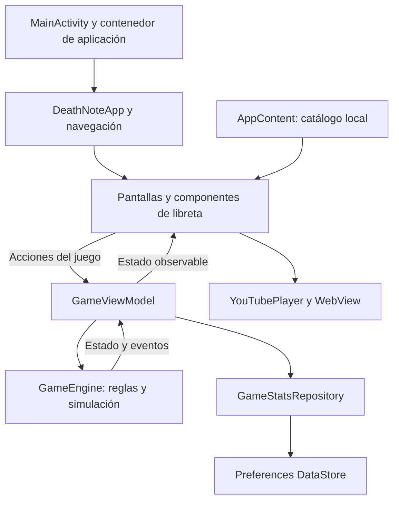
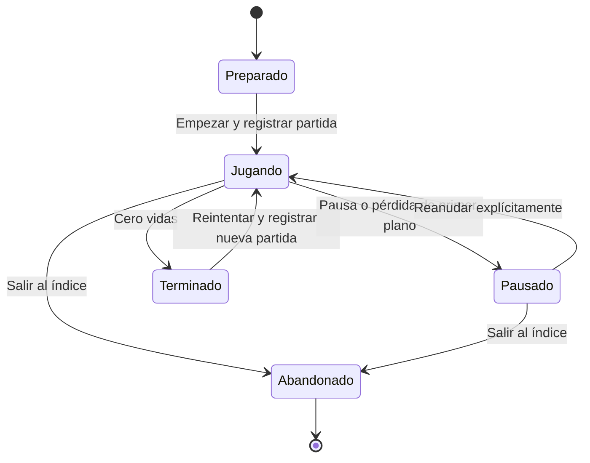

# Plan técnico — Death Note: El Cuaderno

Versión: 1.0 · Estado: aprobado por el usuario · Fase de origen: Plan.

Aprobación registrada: el usuario indicó «Apruebo, pasa a Tasks». Autoriza el desglose de tareas; Implementation y Verification requieren sus respectivas aprobaciones posteriores.

Base funcional: [Specification 1.0](specification.md), aprobada por el usuario al indicar «Pasemos exclusivamente al plan». Este documento define cómo construir la aplicación. El desglose correspondiente se encuentra en [Tasks](tasks.md), pendiente de aprobación propia.

## 1. Resultado previsto

Aplicación Android de una actividad, con Kotlin y Jetpack Compose, seis vistas de contenido y un índice adicional. La identidad visual se construirá con componentes locales que evoquen una libreta oscura. Personajes y Momentos tendrán detalles propios; Acerca de conservará su destino independiente.

El contenido se distribuirá con el APK. El juego utilizará un motor pequeño de Kotlin y dibujo con Compose Canvas. Las estadísticas se guardarán con Preferences DataStore. Los videos se reproducirán en un WebView integrado mediante la API IFrame de YouTube.

La entrega académica prevista será un APK de depuración firmado automáticamente, instalable mediante transferencia al teléfono. No requiere una cuenta de publicación. La generación y la instalación se comprobarán en las fases autorizadas, antes de declararlas completadas.

## 2. Base existente e integración

Los siguientes valores se observaron leyendo los archivos del proyecto; no constituyen una compilación validada:

| Elemento | Configuración observada | Tratamiento previsto |
| --- | --- | --- |
| Módulo | `:app` | Mantener un módulo de aplicación. |
| Paquete e identificador | `com.example.deathnote_app` | Conservar para evitar cambios ajenos al alcance. |
| Interfaz | Compose y Material 3 | Sustituir la pantalla de ejemplo por la aplicación. |
| Android mínimo | API 24 | Mantener Android 7.0 como mínimo. |
| compileSdk / targetSdk | 37 / 37 | Mantener, sujeto a disponibilidad real del SDK. |
| AGP | 9.4.1 | Comprobar resolución y compatibilidad al comenzar Implementation. |
| Gradle Wrapper | 9.6.0 | Usar el wrapper del proyecto. |
| Plugin de Compose | Alias Kotlin 2.2.10 | Comprobar alineación con el Kotlin integrado de AGP al sincronizar. |
| Compose BOM | 2026.02.01 | Mantener como base de los artefactos Compose. |
| Lifecycle existente | 2.6.1 | Alinear los artefactos utilizados según la sección 3. |
| JVM del daemon | Toolchain 25 | Distinguir de la compatibilidad del código fuente, actualmente Java 11. |
| SDK local | Hay una ruta declarada en `local.properties` | Comprobar SDK, herramientas y dispositivo disponibles en Implementation. |
| Permisos de internet | Aún no declarados en el manifiesto | Añadir los necesarios para el reproductor y el estado de conexión. |

La [matriz de AGP 9.4](https://developer.android.com/build/releases/agp-9-4-0-release-notes) documenta Gradle 9.6.0, JDK mínimo 17 y soporte de API 37. La [matriz de Gradle](https://docs.gradle.org/current/userguide/compatibility.html) contempla ejecutar Gradle con Java 25 desde 9.1.0. Estas referencias orientan la integración; la combinación exacta del proyecto sigue pendiente de sincronización y compilación reales.

Las correcciones de integración se limitarán a lo necesario para compilar y mantener API 24. Una incompatibilidad que exija cambiar plataforma o alcance se documentará antes de continuar con ese cambio.

## 3. Herramientas y dependencias

| Responsabilidad | Elección prevista | Motivo |
| --- | --- | --- |
| Pantallas y componentes | Compose UI, Foundation, Animation y Material 3, bajo el BOM existente | Aprovechar la base y compartir estilo entre pantallas. |
| Navegación | `androidx.navigation:navigation-compose:2.10.2` | Administrar destinos, pila y transiciones con una biblioteca estable. |
| Estado y ciclo de vida | Lifecycle Runtime Compose, ViewModel Compose y Runtime KTX, alineados inicialmente en 2.10.0 | Recoger estado según visibilidad y controlar pausa sin mezclarla con el dibujo. |
| Persistencia | `androidx.datastore:datastore-preferences:1.2.1` | Guardar tres estadísticas pequeñas mediante actualizaciones transaccionales. |
| Videos | WebView del sistema, `AndroidView` y API IFrame de YouTube | Reproducción dentro de Compose con control del ciclo de vida. |
| Imágenes de contenido | Archivos en `assets/images/`, cargados localmente | Permitir rutas pendientes y detectar archivos ausentes sin depender de red. |
| Juego y elementos decorativos | Compose Canvas y recursos vectoriales locales | Funcionamiento inmediato sin fotos ni descargas pendientes. |
| Dependencias entre componentes | Contenedor de aplicación y fábricas manuales de ViewModel | Una sola instancia de almacenamiento, con construcción explícita. |

Las versiones seleccionadas aparecen en las referencias oficiales de [Navigation](https://developer.android.com/jetpack/androidx/releases/navigation), [Lifecycle](https://developer.android.com/jetpack/androidx/releases/lifecycle) y [DataStore](https://developer.android.com/jetpack/androidx/releases/datastore). Se fijarán en el catálogo TOML durante Implementation; su resolución conjunta aún no se ha comprobado.

Navigation 2 está en mantenimiento según su documentación oficial. Se elige para este alcance por su pila y sus transiciones conocidas; no necesitamos las nuevas funciones de Navigation 3 para cumplir las vistas acordadas.

Las rutas usarán nombres fijos e identificadores simples; no se necesita añadir un plugin de serialización. El reproductor utilizará directamente la API IFrame, sin una biblioteca de reproducción adicional. Las consultas a la API de datos de YouTube y la búsqueda automática de videos quedan fuera del diseño.

Convención adicional indicada por el usuario después de aprobar Plan: código e identificadores en inglés, interfaz en español, comentarios y textos descriptivos del código opcionalmente en español y commits en inglés. El detalle se mantiene en [CONTRIBUTING.md](../CONTRIBUTING.md). Esta instrucción no cambia el alcance funcional ni autoriza por sí sola Implementation.

## 4. Arquitectura y estado

La interfaz enviará acciones y representará estados. Un ViewModel de juego coordinará la partida y el repositorio de estadísticas; el motor del juego resolverá movimiento, colisiones y puntuación sin depender de Android. Las pantallas informativas leerán el catálogo local y conservarán únicamente su estado de presentación.

Decisión alineada con las [recomendaciones de arquitectura de Android](https://developer.android.com/topic/architecture/recommendations): flujo de estado en una dirección y ViewModel para lógica de pantalla. La separación propuesta aquí se limita a las responsabilidades concretas de esta app.

### Distribución prevista

Las siguientes rutas son propuestas; todavía no se crearán archivos de implementación:

| Área bajo `app/src/main/` | Responsabilidad |
| --- | --- |
| `java/com/example/deathnote_app/MainActivity.kt` | Entrada Android y contenido Compose. |
| `java/com/example/deathnote_app/app/` | Contenedor de dependencias y raíz de la aplicación. |
| `java/com/example/deathnote_app/navigation/` | Rutas, pila y coordinación de transiciones. |
| `java/com/example/deathnote_app/data/content/AppContent.kt` | Frases, personajes, momentos, ficha de la obra y perfil. |
| `java/com/example/deathnote_app/data/stats/` | Repositorio, modelo de estadísticas y DataStore. |
| `java/com/example/deathnote_app/game/` | Motor, modelos de partida y eventos del juego. |
| `java/com/example/deathnote_app/ui/screens/` | Portada, índice, listados, detalles, acerca de, juego y contacto. |
| `java/com/example/deathnote_app/ui/components/` | Página, encabezados, imágenes, placeholders y navegación compartida. |
| `java/com/example/deathnote_app/ui/player/` | WebView, estado del reproductor y adaptación de enlaces de YouTube. |
| `java/com/example/deathnote_app/ui/game/` | ViewModel del juego, Canvas, marcador y paneles de pausa o resultado. |
| `java/com/example/deathnote_app/ui/theme/` | Paleta, tipografía y formas. |
| `assets/images/` | Imágenes sustituibles de portada, personajes, momentos y perfil. |
| `assets/player/` | Plantilla HTML local del reproductor. |
| `res/values/strings.xml` | Etiquetas de interfaz y mensajes reutilizados. |

## 5. Navegación y libreta

### Destinos

| Destino | Acceso | Regreso |
| --- | --- | --- |
| Portada | Arranque y entrada Portada del índice | «Abrir cuaderno» lleva al índice; Atrás permite salir. |
| Índice | «Abrir cuaderno» o regreso desde sección | Atrás lleva a Portada. |
| Personajes | Índice | Índice. |
| Detalle de personaje | Personajes, con identificador de personaje | Personajes; acceso explícito al índice. |
| Momentos | Índice | Índice. |
| Detalle de momento | Momentos, con identificador de momento | Momentos; acceso explícito al índice. |
| Acerca de | Entrada propia del índice | Índice. |
| Juega Conmigo | Índice | Índice, abandonando la partida activa. |
| Contrátame | Índice | Índice. |

Portada será el destino inicial. Volver a ella desde el índice retirará las entradas superiores hasta la portada existente. Las acciones «Índice» retirarán detalles y secciones hasta el índice existente. Usar navegación única para una misma pulsación y aceptar un nuevo cambio cuando termine la transición. Un identificador desconocido mostrará un estado de contenido no disponible con regreso seguro.

La barra superior incluirá Atrás y un acceso al índice donde corresponda. El índice será el menú principal; su composición tendrá título, seis entradas numeradas y señales visuales de margen, encuadernado y número de página.

### Animación de página

Se propone una duración inicial de **450 ms**, con giro alrededor del borde izquierdo, perspectiva, sombra gradual y un desplazamiento breve. La dirección se invertirá al regresar. La transición debe verse como una hoja que se abre o cierra; la textura, el lomo y la sombra reforzarán el efecto.

Navigation controlará la pila. Un componente `BookPage` conectado al estado de transición del destino aplicará el giro mediante `graphicsLayer`, mientras el host coordina entrada y salida. Las [transformaciones de Compose](https://developer.android.com/develop/ui/compose/graphics/draw/modifiers) permiten rotación y transformación de capas; la apariencia de libreta descrita es el diseño propuesto para la app.

El WebView se activará al finalizar la entrada al detalle y se pausará antes de abandonarlo para evitar una superficie de video activa durante el giro. La animación no ejecutará acciones de reproducción. No se usarán capturas de video para simular páginas.

### Estilo compartido

- Fondo negro carbón, páginas gris oscuro, texto marfil y acentos rojos; tema oscuro fijo para preservar la identidad visual aunque el teléfono use otro tema.
- Tipografía serif para títulos y una familia de lectura para párrafos, inicialmente mediante familias disponibles en el sistema.
- Márgenes, líneas y sombras dibujados localmente; la decoración acompañará el contenido sin cubrir texto ni controles.
- Objetivos táctiles mínimos de 48 dp en controles habituales, contenido desplazable e insets del sistema respetados.
- Títulos, botones y paneles con el mismo lenguaje visual en las seis vistas.

## 6. Portada y contenido local

### Slider

Usar `HorizontalPager` de Compose Foundation, tres diapositivas y un indicador de posición. El contador de cinco segundos estará ligado a la portada visible y en primer plano. Arrastrar o mantener una interacción suspenderá el avance; al terminar, se iniciará una nueva cuenta de cinco segundos. El cambio automático seguirá el ciclo 1 → 2 → 3 → 1.

El [pager de Compose](https://developer.android.com/develop/ui/compose/layouts/pager) ofrece desplazamiento manual, indicadores y avance programado. El reinicio del contador y la suspensión por ciclo de vida se ajustarán a RF-01.

### Catálogo editable

`AppContent.kt` reunirá los datos que el usuario cambiará: imágenes, frases, personajes, momentos, enlaces de YouTube y perfil. Cada elemento tendrá un identificador estable; las relaciones entre listado y detalle usarán ese identificador.

| Modelo de contenido | Datos principales |
| --- | --- |
| Diapositiva | Identificador, frase, ruta de imagen opcional y descripción accesible. |
| Personaje | Identificador, nombre, rol, descripción y ruta de foto opcional. |
| Momento | Identificador, título, descripción, ruta de imagen opcional y enlace de YouTube opcional. |
| Ficha del anime | Sinopsis, temporada, episodios, autores y estudio. |
| Perfil | Nombre, presentación, foto, correo, teléfono y enlaces; campos pendientes admitidos. |

Las imágenes se cargarán desde `assets/images/` con lectura fuera del hilo principal, ajuste al tamaño necesario y caché en memoria limitada. Una ruta vacía, un archivo ausente o un error de decodificación mostrará el placeholder contextual. La caché conservará únicamente datos de imagen y no referencias a actividades.

Las fotografías de los listados se reutilizarán en sus detalles. Antes de haber fotos reales, las vistas conservarán sus espacios y etiquetas pendientes. Al sustituirlas, el usuario añadirá el archivo y editará su ruta en el catálogo; posteriormente generará otro APK. La guía final incluirá ejemplos con rutas reales existentes.

Contrátame representará los datos configurados y sus placeholders. El plan base muestra la información como texto y permite copiar datos reales mediante selección; no añade un formulario ni un sistema de mensajería. Los placeholders nunca producirán acciones hacia contactos ficticios.

## 7. Reproducción de YouTube

### Integración elegida

Un `YouTubePlayer` reutilizable alojará un WebView nativo mediante `AndroidView`. La plantilla HTML local creará el reproductor IFrame para el identificador extraído del enlace. [AndroidView](https://developer.android.com/develop/ui/compose/migrate/interoperability-apis/views-in-compose) permite integrar vistas Android en Compose.

Se aceptarán inicialmente enlaces HTTPS de `youtube.com/watch?v=…`, `youtu.be/…`, `youtube.com/embed/…` y `youtube.com/shorts/…`, incluyendo el dominio `www.youtube.com`. El adaptador extraerá y validará el identificador antes de construir el reproductor. Las marcas de tiempo del enlace no serán necesarias para el flujo inicial; los videos elegidos deberán representar la escena deseada.

La configuración se hará con enlace completo en `AppContent.kt`. Un valor vacío producirá «Video pendiente de configurar», sin crear el WebView ni intentar acceder a internet.

### Tamaño, controles y ciclo de vida

- Reproductor con controles visibles, reproducción iniciada por el usuario y sin pantalla completa requerida.
- Área adaptable al ancho, con altura suficiente para respetar el mínimo de 200 × 200 píxeles CSS que exige la [API IFrame](https://developers.google.com/youtube/iframe_api_reference#Requirements); usar proporción 16:9 cuando el espacio lo permita.
- Mantener los controles y la identificación de YouTube visibles, con los mensajes de la app fuera de la superficie del video.
- Pausar al perder el estado de primer plano del detalle. Al retirar el destino, detener el reproductor y liberar el WebView y sus referencias.
- Reintentar reconstruirá la instancia cuando sea necesario; el texto del momento seguirá siendo nativo y accesible durante carga o error.
- El flujo de reproducir y reintentar permanecerá dentro del detalle; la app no creará intents para enviar al usuario a YouTube o al navegador como alternativa a un error.

### Identificación y estado de conexión

Se prevé cargar el HTML con `loadDataWithBaseURL`, usando un origen HTTPS derivado del identificador instalado de la app y configurando el mismo origen para la API IFrame. Así se proporcionará la identidad del cliente indicada en la [documentación oficial para WebView](https://developers.google.com/youtube/terms/required-minimum-functionality#api-client-identity-and-credentials), incluso para distribución por APK.

Se declararán `INTERNET` y `ACCESS_NETWORK_STATE`, permisos normales sin diálogo de ejecución. La conectividad servirá para orientar los mensajes; el resultado real de carga seguirá siendo la autoridad para saber si el video puede reproducirse. La ausencia de WebView utilizable también tendrá un estado de error recuperable para el resto de la aplicación.

### Estados y comunicación

Estados previstos: pendiente de configurar, sin conexión, cargando, listo, reproduciendo, pausado y error. La capa nativa recibirá únicamente eventos de estado y error del reproductor. La comunicación JavaScript tendrá funciones mínimas, sin exponer archivos o acciones del dispositivo, y la navegación principal del WebView se limitará al flujo necesario del reproductor.

El [catálogo oficial de errores](https://developers.google.com/youtube/iframe_api_reference#onError) distingue enlaces inválidos, contenido no disponible, inserción impedida y ausencia de identificación. Se traducirán a mensajes breves; un error no activará redirecciones ni reproducirá otro video arbitrario. Un tiempo de carga excesivo ofrecerá reintentar sin dejar un indicador indefinido.

La reproducción real de las tres escenas dependerá de sus enlaces y de la disponibilidad de YouTube. Se podrá verificar el comportamiento de placeholders antes de recibirlos; el criterio CA-13 seguirá pendiente hasta comprobar cada video real.

## 8. Juego: motor, representación y pausa

### Motor y dibujo

`GameEngine` recibirá acciones y tiempo transcurrido; devolverá estado y eventos, como manzana recogida, vida perdida o partida terminada. El estado contendrá posición de Ryuk, objetos activos, puntos, vidas, nivel, tiempo activo y tiempo de invulnerabilidad restante.

Compose Canvas dibujará el escenario, Ryuk y los objetos. Ryuk tendrá una representación vectorial reconocible por su silueta, cabello y rostro; las manzanas serán rojas y los obstáculos tendrán otra forma y color. Los recursos serán parte de la aplicación y no dependerán de las fotos de Personajes.

Las posiciones utilizarán coordenadas relativas al área útil para adaptarse a teléfonos de distintas medidas. El arrastre horizontal actualizará la posición objetivo, limitada a los bordes. El marcador y los controles estarán fuera del área de colisión.

Un bucle asociado a los cuadros de Compose avanzará la simulación solo en estado Jugando. Usará tiempo monotónico y pasos de simulación pequeños para evitar atravesar objetos entre cuadros. Al reanudar, reiniciará la referencia temporal; ningún intervalo pasado en segundo plano se aplicará como un salto de movimiento.

### Estados de partida

`GameViewModel` pertenecerá al destino del juego. Pausar conserva el estado en memoria. Salir al índice retirará el destino y descartará esa partida. El estado de la partida no se escribirá en `SavedStateHandle` ni en disco para recuperarlo después de la muerte del proceso. Las estadísticas sí se guardarán de forma independiente.

### Aplicación de las reglas aprobadas

| Regla | Resolución técnica |
| --- | --- |
| Tres vidas y diez puntos por manzana | Constantes de reglas del motor. |
| Una colisión, un resultado | Identificadores de objeto y retirada del objeto procesado. |
| Un segundo de invulnerabilidad | Contador de tiempo activo; indicador visual durante la protección. |
| Manzanas perdidas sin penalización | Retirada de objetos fuera del área sin evento de daño. |
| Dificultad cada veinte segundos, máximo cinco niveles | Tabla de velocidad y frecuencia indexada por tiempo activo. |
| Pausa real | Suspender simulación, aparición de objetos, dificultad e invulnerabilidad. |
| Partida nueva | Restaurar estado inicial y emitir un único evento de inicio. |

La tabla concreta de velocidades y frecuencias se calibrará al implementar y verificar el juego, como prevé RG-03. Se limitará la cantidad de objetos activos para mantener fluidez; ese límite no permitirá acumular objetos fuera de pantalla. Los obstáculos generados deberán dejar espacio para maniobrar.

## 9. Estadísticas y almacenamiento

Un único `GameStatsRepository`, creado por el contenedor de la aplicación, gestionará un archivo Preferences DataStore. La [guía de DataStore](https://developer.android.com/topic/libraries/architecture/datastore) exige una instancia por archivo y proceso; sus actualizaciones permiten conservar los valores de forma transaccional.

| Dato persistido | Tipo previsto | Actualización |
| --- | --- | --- |
| Récord | Entero largo, inicial 0 | Máximo entre el valor guardado y la puntuación alcanzada. |
| Partidas jugadas | Entero largo, inicial 0 | Sumar uno al aceptar Empezar o Reintentar desde un estado permitido. |
| Manzanas recogidas | Entero largo, inicial 0 | Sumar uno por evento de recogida emitido por el motor. |

El repositorio serializará los eventos de estadísticas y actualizará en una misma operación las manzanas y el récord afectados por una recogida. Se guardarán eventos, no cuadros de animación. Las escrituras tendrán un alcance de aplicación para que retirar la pantalla no cancele una actualización pendiente.

La vista mostrará el estado de carga de estadísticas antes de permitir iniciar una partida; un valor provisional de cero no sobrescribirá datos existentes. La máquina de estados impedirá contar dos inicios por doble pulsación. La UI observará estadísticas mediante Flow y mostrará un error recuperable si una operación de almacenamiento falla, sin declarar guardados valores que no se hayan confirmado.

El repositorio conservará las operaciones pendientes en memoria para un reintento de escritura. El plan no promete recuperar eventos que todavía no se hubieran confirmado cuando el sistema termine abruptamente el proceso. En cierres normales se procesarán las operaciones ya emitidas; esta distinción se comprobará y documentará al verificar la persistencia.

## 10. Estrategia de verificación futura

Esta sección diseña la cobertura. **No autoriza ejecutar Verification ahora ni registra comprobaciones realizadas.** La matriz completa de resultados se elaborará en esa fase usando los [criterios aprobados](acceptance-criteria.md).

| Área | Comprobación prevista | Referencias |
| --- | --- | --- |
| Entorno y APK | Sincronización, compilación de depuración, instalación y apertura en Android disponible; documentar versiones efectivas. | CA-40. |
| Navegación | Recorrer las seis entradas, detalles, Atrás, regreso al índice y pulsaciones rápidas. | CA-05 a CA-11, CA-20. |
| Portada | Deslizamiento, ciclo automático, reinicio del contador y suspensión al ocultarse. | CA-01 a CA-04. |
| Video | Pendiente, error, sin conexión, reintento, pausa por ciclo de vida y reproducción de cada enlace real. | CA-12 a CA-17. |
| Contenido | Sustitución de imágenes locales, campos vacíos y visualización offline. | CA-18 a CA-23. |
| Motor | Casos deterministas de puntos, colisiones, invulnerabilidad, dificultad y pausa. | CA-24 a CA-30. |
| Persistencia | Eventos contabilizados una vez, conservación del máximo y totales tras abandonar, cerrar y abrir. | CA-31 a CA-36. |
| Presentación | Teléfono compacto y otro tamaño disponible; texto ampliado, insets, legibilidad y controles. | CA-37 a CA-39. |

Al autorizar Verification, las pruebas automatizadas se concentrarán en las reglas del motor y en las actualizaciones de estadísticas, donde un error afecta el comportamiento. El video y la apariencia de la libreta requerirán observación en dispositivo o emulador. Ninguna comprobación estática sustituirá la reproducción real de los tres videos.

La compatibilidad mínima se comprobará en API 24 si hay un dispositivo o emulador disponible. También se comprobará una versión reciente disponible. Si solo puede verificarse una versión, el informe distinguirá la compatibilidad declarada de la realmente probada.

## 11. APK, recursos y documentación de entrega

La ruta prevista del artefacto de depuración es `app/build/outputs/apk/debug/app-debug.apk`, después de ejecutar la tarea de ensamblado correspondiente en la fase autorizada. El nombre visible de la aplicación será Death Note: El Cuaderno, aunque se conserve su identificador actual.

La guía de entrega documentará generación e instalación, versión de Android utilizada y cambios de recursos. También identificará el catálogo central, las rutas de imágenes y los campos de YouTube y contacto. Los recursos personales o videos pendientes se registrarán como tales en el informe, conforme a CA-41.

Los documentos de especificación seguirán siendo la referencia funcional; este plan describirá la solución aprobada y se actualizará si aparecen ajustes técnicos necesarios. Tasks enlazará posteriormente cada unidad de trabajo con los requisitos y criterios correspondientes.

## 12. Distribución orientativa del plazo

El plazo comunicado es de tres días desde el inicio del proyecto. Esta distribución orienta el trabajo y depende de aprobar cada fase; no sustituye esas aprobaciones.

| Tramo | Resultado buscado al llegar a las fases autorizadas |
| --- | --- |
| Primer día | Plan y Tasks aprobados; base compilable, identidad de libreta, navegación y contenido con placeholders. |
| Segundo día | Integración del juego, persistencia y reproductor; sustitución de recursos que ya estén disponibles. |
| Tercer día | Verification, correcciones necesarias, comprobación de videos reales y entrega del APK con documentación. |

El juego y el reproductor concentran la incertidumbre técnica. Deben recibir atención temprana durante Implementation para conservar margen para corregirlos. Las fotografías y enlaces pueden incorporarse después de construir sus estados pendientes, pero deben estar disponibles antes de aceptar por completo los recursos exigidos por la asignación.

## 13. Riesgos concretos y respuesta prevista

| Riesgo | Efecto | Respuesta prevista |
| --- | --- | --- |
| SDK, dependencias o JVM no disponibles o incompatibles | Impide generar el APK. | Resolver la integración al inicio de Implementation, registrar versiones efectivas y mantener minSdk 24. |
| Video que impide inserción o desaparece | Un momento no reproduce su escena. | Mostrar error dentro de la app y sustituir el enlace por otro autorizado para inserción. |
| Identificación insuficiente del WebView | YouTube rechaza la reproducción. | Configurar origen y Referer según la documentación oficial y comprobarlo con un video reproducible. |
| WebView antiguo o no disponible | Falla la carga del reproductor. | Error contextual sin perder el contenido; registrar el entorno probado y la dependencia de WebView. |
| Recursos reales aún pendientes | Las fotos y los videos finales no pueden aceptarse. | Mantener inventario y estados pendientes; distinguirlos de funcionalidades verificadas. |
| Salto temporal al regresar al juego | Daño o dificultad inesperados. | Pausa por ciclo de vida y reinicio de la referencia temporal al reanudar. |
| Escritura cancelada al salir de la pantalla | Pérdida de récord o estadísticas. | Repositorio con alcance de aplicación, eventos serializados y actualización al ocurrir cada evento. |
| Transición costosa o video durante el giro | Animación entrecortada o superficie superpuesta. | Transición breve con capas de Compose y activación del WebView al estar el detalle en primer plano. |
| Retraso en aprobaciones o recursos | Reduce el margen del plazo de tres días. | Mantener visible el estado de cada fase y contenido; ajustar fechas sin saltarse aprobaciones. |

## 14. Cierre de esta fase

Plan queda aprobado con arquitectura, decisiones de integración, estructura prevista, navegación, diseño, manejo de contenido, juego, almacenamiento, reproductor y estrategia de entrega definidos.

En esta fase se han realizado únicamente lectura del proyecto, consulta de documentación oficial y cambios Markdown. No se han modificado archivos Kotlin, Gradle, recursos o manifiesto; no se ha compilado ni ejecutado la aplicación.

**Tasks fue autorizada al aprobar este plan.** El desglose se presenta para revisión en su documento; Implementation y Verification requieren sus respectivas aprobaciones posteriores.
