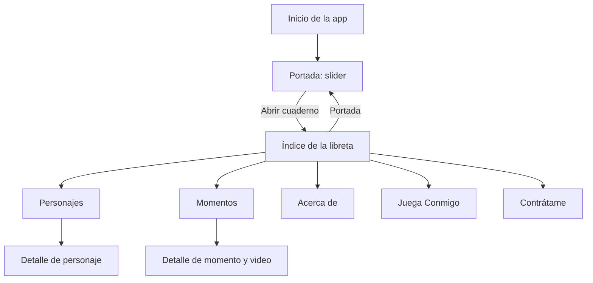

# Especificación — Death Note: El Cuaderno

Versión: 1.0 · Estado: aprobada por el usuario · Fase de origen: Specification.

Aprobación registrada: el usuario indicó «Pasemos exclusivamente al plan». Autoriza la elaboración de Plan; Tasks, Implementation y Verification requieren sus respectivas aprobaciones posteriores.

## 1. Objetivo

Construir una aplicación Android instalable dedicada al anime original de Death Note que cumpla las seis vistas de la asignación: Portada, Personajes, Momentos, Acerca de, Juega Conmigo y Contrátame. La experiencia debe recordar una libreta oscura cuyo índice permite explorar el contenido mediante transiciones de página.

El juego debe ser una experiencia de habilidad relacionada con Ryuk y las manzanas. Toda la información y el juego estarán disponibles sin conexión; los videos integrados de YouTube requieren internet.

## 2. Acuerdos y alcance

| Área | Requisito confirmado |
| --- | --- |
| Nombre | Death Note: El Cuaderno. |
| Plataforma | Android; Kotlin y Android Studio, aprovechando el proyecto existente con Jetpack Compose. |
| Disposición | Interfaz en español y orientación vertical. |
| Estética | Libreta oscura con negro, blanco y acentos rojos. |
| Inicio | Portada con slider → botón «Abrir cuaderno» → índice. |
| Navegación | Seis entradas en el índice; animación de página al abrir una sección. |
| Personajes | Light Yagami, L y Ryuk; listado y detalle individual. |
| Momentos | Tres escenas elegidas por el usuario; listado y detalle con video integrado. |
| Spoilers | Permitidos de toda la serie. |
| Acerca de | Anime original: sinopsis, temporadas, episodios, autores del manga y estudio de animación. |
| Juego | Ryuk se mueve horizontalmente por arrastre para recoger manzanas y evitar obstáculos; tres vidas y dificultad creciente. |
| Persistencia | Récord, partidas jugadas y manzanas recogidas. Sin recuperación de partidas después de cerrar la app. |
| Ciclo de vida | Pausa automática al pasar a segundo plano. |
| Recursos pendientes | Placeholders identificados; sustitución mediante archivos del proyecto. |
| Contacto | Foto y todos los datos personales inicialmente como placeholders. |
| Sonido | Sin música ni efectos propios de la app o del juego. El video conserva su audio y controles habituales. |
| Entrega | APK instalable; plazo comunicado de tres días. |

Los valores de puntuación, colisiones y dificultad de la sección 6 forman parte de la especificación aprobada.

## 3. Vistas y recorrido

Portada y las otras cinco secciones constituyen las seis vistas requeridas. El índice es una pantalla adicional de navegación. Los detalles de personaje y momento son pantallas subordinadas a sus respectivos listados.

**Momentos y Acerca de son vistas independientes, con entradas diferentes en el índice.**

Cada sección permite volver al índice. Desde un detalle, Atrás regresa primero a su listado. Desde el índice, Atrás lleva a la portada; desde la portada, permite salir de la actividad según el comportamiento de Android. Volver a Portada desde el índice reutiliza la misma vista y no apila recorridos duplicados.

## 4. Requisitos funcionales

### RF-01. Portada

- Mostrar el nombre de la aplicación y tres diapositivas con frase y recuadro de imagen identificado como placeholder.
- Permitir deslizar manualmente, mostrar la posición actual y avanzar automáticamente cada cinco segundos.
- Al llegar a la tercera diapositiva, continuar con la primera.
- Reiniciar la cuenta de cinco segundos después de una interacción manual; suspender el avance si la portada deja de estar visible o la app pasa a segundo plano.
- Incluir «Abrir cuaderno», que abre el índice con una transición coherente con la libreta.

### RF-02. Índice y transiciones

- Mostrar seis entradas claramente legibles: Portada, Personajes, Momentos, Acerca de, Juega Conmigo y Contrátame.
- Representar visualmente el índice de una libreta; numerar las entradas o usar elementos equivalentes de una página de índice.
- Aplicar una animación reconocible de cambio de página al abrir una sección y una transición coherente al regresar.
- Mantener la navegación estable ante pulsaciones repetidas durante una transición.

### RF-03. Personajes

- Mostrar al menos Light Yagami, L y Ryuk, cada uno seleccionable por su nombre.
- Abrir un detalle con nombre, espacio de fotografía, rol y descripción específica del personaje.
- Usar placeholders identificados para las fotos mientras no se configuren recursos locales.
- Permitir regresar al listado y al índice mediante la navegación definida.

### RF-04. Momentos

- Mostrar exactamente los tres momentos seleccionados, cada uno con título y fotografía o placeholder.
- Abrir un detalle propio con título, imagen, explicación de la escena y espacio de reproductor integrado.
- Momentos iniciales: Light y la papita; Light recupera sus recuerdos al tocar la Death Note en el helicóptero; Ryuk cumple su promesa en el desenlace.
- Mantener el contenido de Momentos separado de Acerca de.

### RF-05. Video integrado

- Configurar un enlace de YouTube por momento desde el proyecto. El mecanismo técnico se decidirá en Plan.
- Reproducir el video dentro del detalle, por acción del usuario, sin abrir YouTube ni un navegador para cumplir el flujo de reproducción.
- Mostrar controles de reproducción; no iniciar el video automáticamente al abrir el detalle.
- Mostrar estados de enlace pendiente, carga, error y ausencia de conexión sin impedir leer el resto de la pantalla.
- Permitir reintentar la carga cuando exista un enlace configurado.
- Ante un enlace inválido, video eliminado, privado o que impida inserción, informar dentro de la app; no usar una salida externa como sustitución.
- Detener o pausar la reproducción al abandonar el detalle o enviar la app a segundo plano. No debe quedar audio reproduciéndose detrás de otra vista.
- Conservar la reproducción en vertical dentro de la aplicación; la reproducción en pantalla completa no es un requisito de esta versión.

### RF-06. Acerca de

- Disponer de una vista independiente con sinopsis original redactada para la app y ficha del anime.
- Incluir cantidad de temporadas, total de episodios, autor del guion del manga, dibujante y estudio de animación.
- Identificar los datos del anime original sin mezclar películas, adaptaciones de acción real o especiales con su recuento.
- Mantener la información disponible sin internet.

### RF-07. Juega Conmigo

- Incluir «Ryuk y las manzanas», instrucciones breves y botón para empezar.
- Mostrar Ryuk, manzanas y obstáculos mediante representaciones locales reconocibles; el juego debe funcionar sin recursos remotos.
- Permitir mover a Ryuk horizontalmente con el dedo para atrapar manzanas y esquivar obstáculos que caen.
- Mostrar puntos y vidas durante la partida; ofrecer pausa, reanudación y salida al índice.
- Aumentar la dificultad durante la partida y terminarla al perder las tres vidas.
- Mostrar resultado, récord y opción de reintentar.
- Mostrar récord, partidas jugadas y total de manzanas recogidas en la vista del juego.
- Aplicar las reglas de la sección 6.

### RF-08. Contrátame

- Mostrar una foto de perfil o placeholder y campos para nombre, descripción profesional breve, correo, teléfono y enlaces de redes o portafolio.
- Todos los datos personales comienzan como placeholders claros; no se inventarán identidades ni direcciones reales.
- Los valores pendientes no deben ofrecer acciones que intenten llamar, escribir o abrir direcciones ficticias.
- Los datos se sustituyen desde el proyecto. Un formulario de edición o envío de mensajes no forma parte de esta versión.

### RF-09. Contenido y sustitución de recursos

- Mantener el texto informativo y los recursos necesarios para navegación y juego dentro del APK.
- Facilitar el reemplazo de textos, datos personales, imágenes y enlaces mediante archivos del proyecto sin modificar la lógica de las pantallas.
- Documentar las rutas exactas y el formato de sustitución cuando existan en Implementation.
- Admitir imágenes locales para garantizar su visualización sin internet. La descarga dinámica de imágenes mediante URL no es un requisito.
- Si falta un recurso opcional, conservar la distribución de la vista y mostrar su placeholder; ningún enlace pendiente debe provocar un fallo.

## 5. Diseño y requisitos no funcionales

| ID | Requisito |
| --- | --- |
| RNF-01 | Estética consistente de cuaderno oscuro, con textura o composición que evoque páginas; contenido principal legible. |
| RNF-02 | Tipografías decorativas reservadas para títulos cuando dificulten la lectura del texto largo. |
| RNF-03 | Interfaz vertical que respete barras del sistema y permita desplazarse cuando el contenido no quepa. |
| RNF-04 | Controles habituales con zona táctil de al menos 48 dp; textos descriptivos para iconos relevantes y placeholders. El juego conserva su control por arrastre. |
| RNF-05 | Animaciones breves que no bloqueen la navegación; evitar transiciones duplicadas ante pulsaciones rápidas. |
| RNF-06 | Funcionamiento sin cuenta, servidor propio ni conexión para las vistas de contenido y el juego. |
| RNF-07 | Sin solicitudes de acceso a cámara, micrófono, contactos ni almacenamiento compartido para esta funcionalidad. |
| RNF-08 | Sin efectos de sonido ni música de fondo. El audio del reproductor pertenece al video y responde a sus controles. |
| RNF-09 | APK instalable en Android compatible. La base actual declara minSdk 24, equivalente a Android 7.0; conservar esta compatibilidad salvo cambio aprobado. |
| RNF-10 | Récord y estadísticas disponibles tras cerrar y reabrir la aplicación. La partida activa no se guarda para recuperarla tras cierre o terminación del proceso. |
| RNF-11 | Mantener trazabilidad entre requisitos, decisiones y criterios de aceptación en Markdown. |

## 6. Reglas del juego

### RG-01. Inicio y puntuación

- Cada partida nueva comienza con tres vidas, cero puntos y dificultad inicial.
- Cada manzana atrapada suma **10 puntos** y una unidad al total histórico de manzanas recogidas.
- Una manzana que sale de la pantalla sin recogerse no resta puntos ni vidas.
- Cada objeto se contabiliza una sola vez y se retira al recogerse, colisionar o salir del escenario.

### RG-02. Movimiento y daño

- Ryuk se mueve únicamente en el eje horizontal y permanece dentro del área de juego.
- Chocar con un obstáculo resta una vida, sin descontar puntos.
- Después de recibir daño hay un segundo de invulnerabilidad visible para evitar perder varias vidas por contactos simultáneos.
- Los obstáculos atravesados durante esa invulnerabilidad no añaden daño.
- Al llegar a cero vidas, detener la simulación y mostrar el resultado final.

### RG-03. Dificultad

- La dificultad aumenta cada 20 segundos de juego activo hasta un máximo de cinco niveles.
- Cada nivel aumenta la velocidad de caída y la frecuencia de aparición respecto al anterior.
- Las velocidades y frecuencias concretas se definirán y documentarán durante la implementación, respetando los cinco niveles y la progresión acordada al aprobar esta especificación.
- La pausa no acumula tiempo de dificultad, movimiento ni apariciones.

### RG-04. Pausa y salida

- El botón Pausa congela la partida; Reanudar continúa desde el mismo estado mientras ese estado siga en memoria.
- Al perder el primer plano, incluyendo bloqueo del teléfono, la partida se pausa automáticamente.
- Al volver, mostrar el estado de pausa y exigir Reanudar para continuar.
- Si se abandona la vista hacia el índice, finalizar la partida activa conservando récord y estadísticas alcanzados. Al entrar de nuevo se ofrece una partida nueva.
- Al cerrar la app o terminarse el proceso, la partida se descarta. No existe un botón para recuperar esa partida en un arranque posterior.

### RG-05. Persistencia y estadísticas

- Récord: puntuación máxima alcanzada entre todas las partidas, incluso una partida abandonada o interrumpida.
- Partidas jugadas: aumentar una vez al iniciar efectivamente una partida nueva. Visitar la vista, pausar o reanudar no aumenta el contador.
- Manzanas recogidas: suma de manzanas atrapadas en todas las partidas, incluidas las abandonadas.
- Actualizar y persistir las estadísticas al producirse el evento correspondiente; no esperar exclusivamente a la pantalla de derrota.
- Reintentar inicia otra partida con tres vidas y cero puntos, conservando los totales históricos.
- La persistencia cubre cierres y reaperturas normales; reinstalar la app, borrar sus datos o fallos del dispositivo no forman parte de la garantía de conservación.

## 7. Estados de contenido

| Situación | Comportamiento esperado |
| --- | --- |
| Imagen pendiente | Recuadro con etiqueta contextual, sin icono de carga permanente ni referencia rota. |
| Contacto pendiente | Campo identificado; acciones inválidas deshabilitadas u omitidas. |
| Video pendiente | Mensaje «Video pendiente de configurar»; el texto del momento sigue disponible. |
| Sin internet | Mensaje sobre la conexión y posibilidad de reintentar; navegación y juego disponibles. |
| Error o restricción de YouTube | Mensaje dentro del detalle y reintento; sin redirección externa. |
| Retorno a juego pausado | Ningún avance hasta pulsar Reanudar. |
| App abierta después de cierre | Estadísticas restauradas; ninguna partida anterior en curso. |

## 8. Entregables y límites

- APK instalable y proyecto Android correspondiente.
- Markdown actualizado de cada fase autorizada.
- Guía de sustitución de recursos y datos personales al existir las rutas definitivas.
- Evidencia de verificación y limitaciones reales al llegar a Verification.

Esta versión no incluye cuentas, sincronización, tablas de clasificación en internet, pantalla de administración, cuestionarios, descarga de videos, recuperación de partidas cerradas ni sonido propio.

La asignación exige fotos y tres videos funcionales. Los placeholders son un estado de desarrollo autorizado, pero **no prueban el cumplimiento de esos recursos finales**. La reproducción real de cada momento se aceptará después de configurar y comprobar sus enlaces. YouTube puede impedir la inserción de un video: véase la [referencia oficial de errores del reproductor](https://developers.google.com/youtube/iframe_api_reference#onError).

## 9. Control de fases

| Fase | Estado | Condición de salida |
| --- | --- | --- |
| Specification | Aprobada | Aprobación registrada al solicitar pasar exclusivamente a Plan. |
| Plan | Aprobado | El usuario indicó «Apruebo, pasa a Tasks». |
| Tasks | Redactadas; pendientes de aprobación | Revisar y aprobar el [desglose de tareas](tasks.md) antes de iniciar Implementation. |
| Implementation | No iniciada | Se implementan las tareas aprobadas; se presentan cambios antes de solicitar Verification. |
| Verification | No iniciada | Se comprueban criterios, APK y recursos; se documentan resultados reales. |

No hay preguntas funcionales bloqueantes pendientes de la entrevista. Los cambios posteriores a estos requisitos deberán registrarse y aprobarse antes de incorporarse al alcance.
